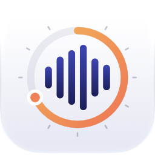
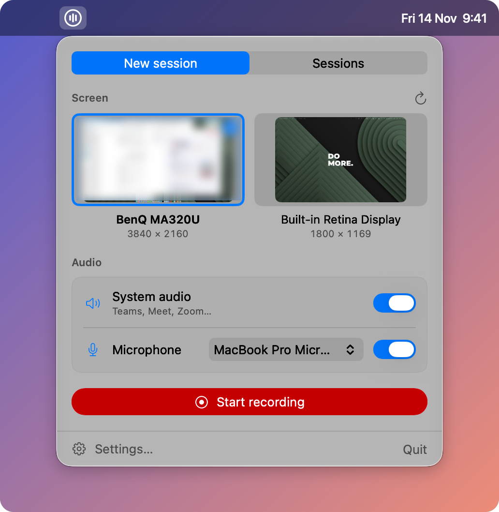
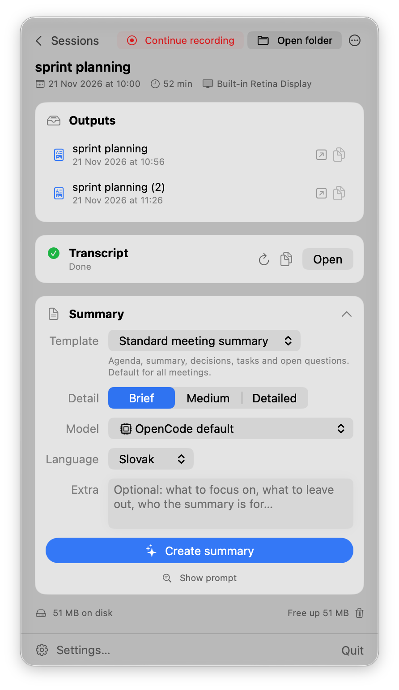
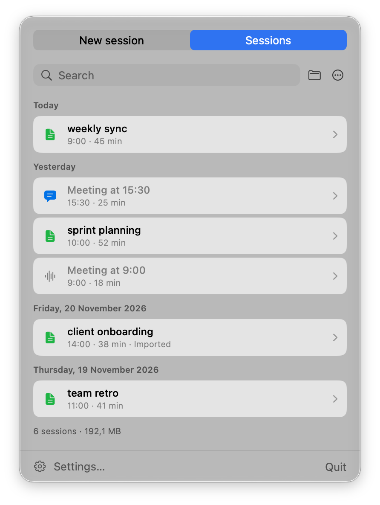
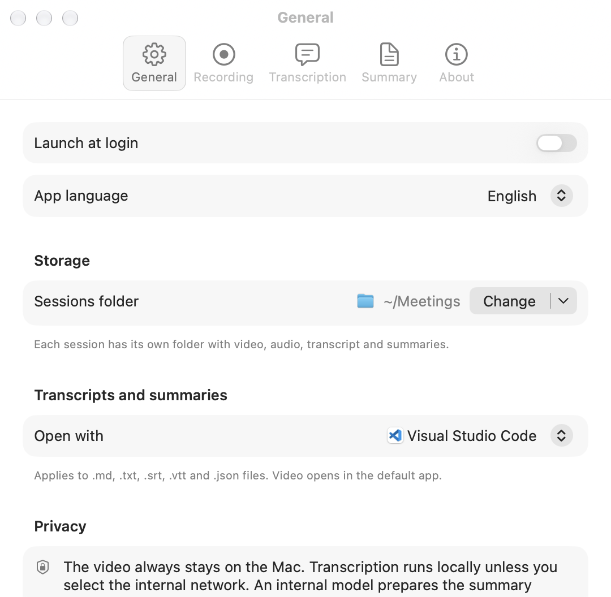
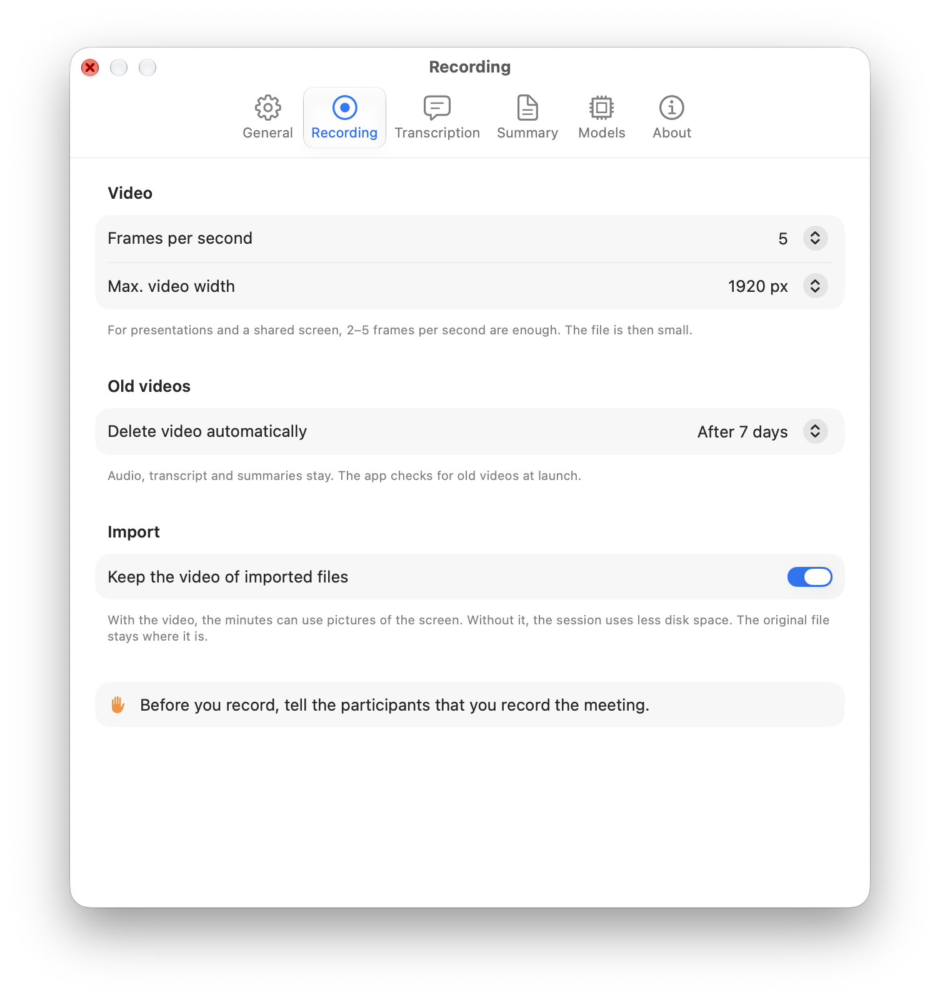
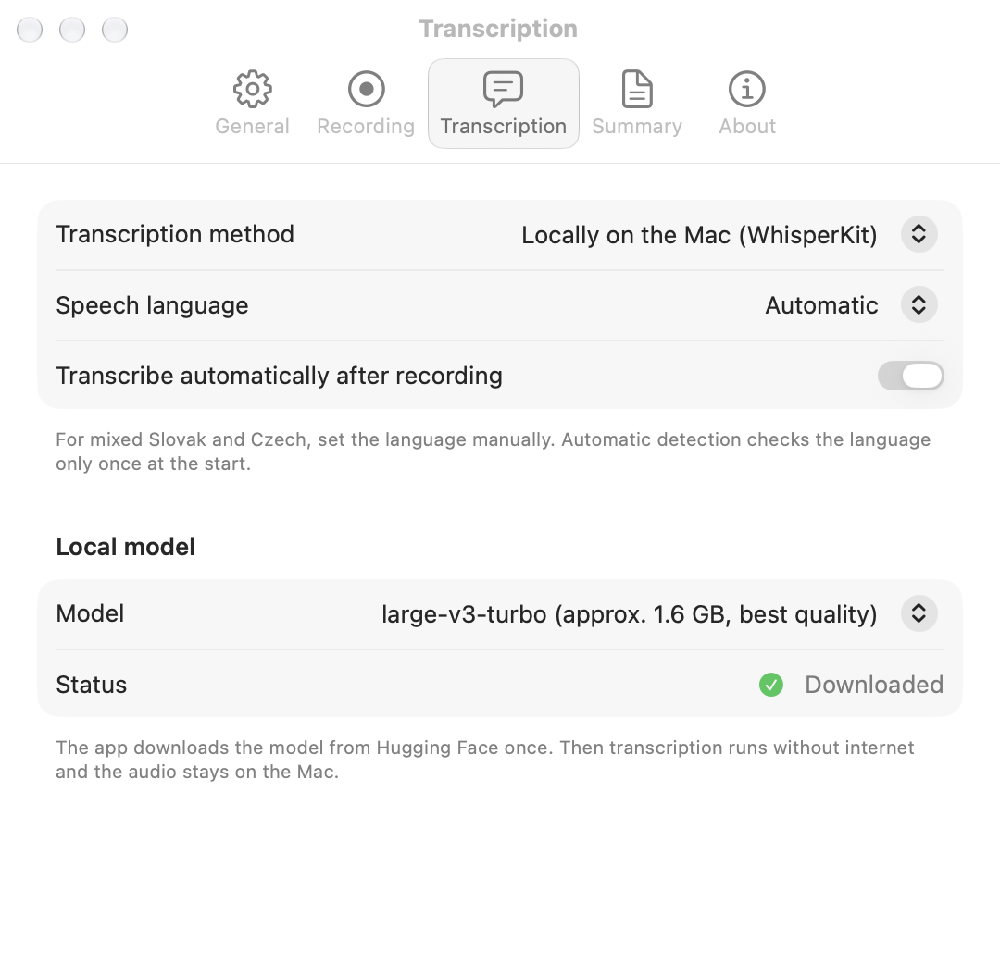
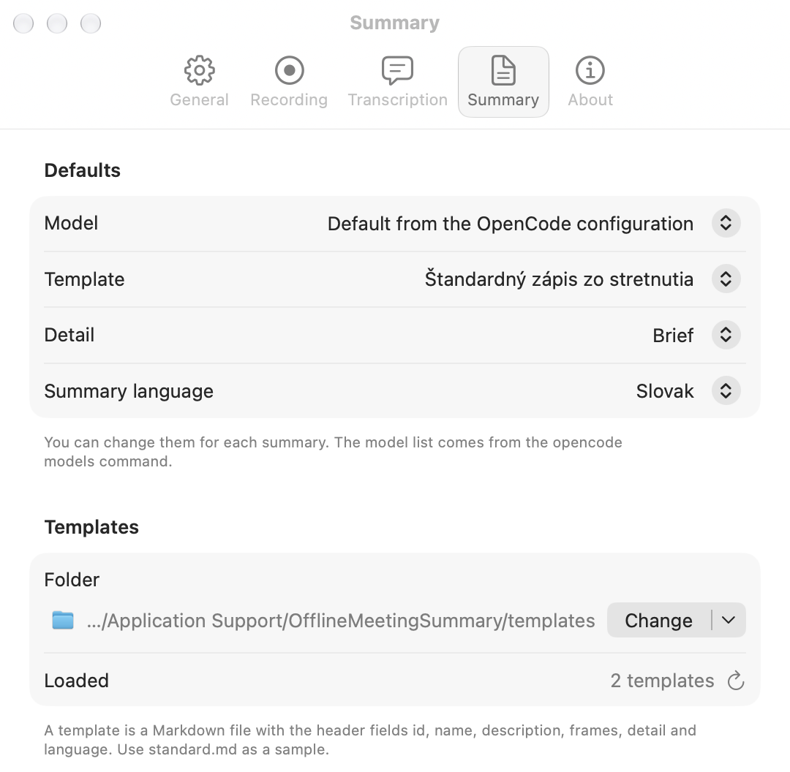
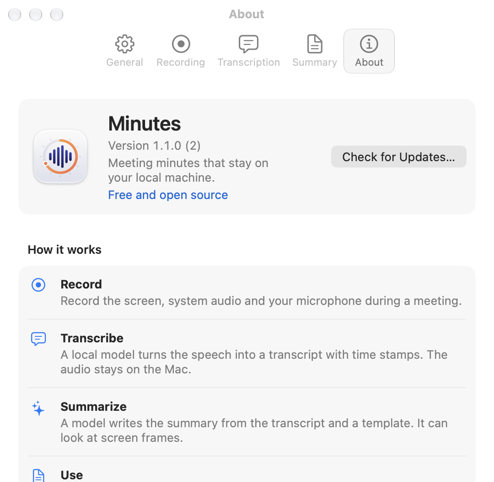

<div align="center">

<picture>
  <source media="(prefers-color-scheme: dark)" srcset="apps/site/images/app-icon-dark.png">
  
</picture>

# Minutes

### Meeting over. *Minutes* done.

Minutes records your meeting, transcribes the speech and writes the minutes from a template.<br>
Video and audio stay on your local machine.

    

**[Download Minutes 1.3.0](https://github.com/softverse-space/minutes/releases/latest)** · [Website and user guide](https://softverse-space.github.io/minutes/) · [Build from source](#build-from-source) · [Changelog](apps/macos/CHANGELOG.md) · [Decisions (ADR)](docs/adr/README.md)

</div>

<p align="center">
  
  
  
</p>

| On your Mac | Slovak, Czech, English | Your template | Open source |
|---|---|---|---|
| Video and audio stay local. | And a mix of them in one meeting. | Standard minutes or your company's format. | No account. No telemetry. |

## How it works

The time stamps follow one meeting from the first click to the minutes, as on the [website](https://softverse-space.github.io/minutes/).

### `00:00` Recording – one click in the menu bar


Click the Minutes icon. Select a screen and the audio sources. Then click **Start recording**.

- **System audio** records the other participants from Teams, Meet or Zoom.
- **Microphone** records you. In the transcript you are “me”, the others are “others”.
- During the recording you see the audio level. You can mute each source.
- Turn off the **Screen** switch to record only audio. The file is then much smaller, but the minutes cannot use pictures of the screen.
- Do you already have a recording? Click **Import a recording…** or drop audio or video files on the popover. The app copies them and starts the transcription. The original files stay where they are.

> [!IMPORTANT]
> Before you record, tell the participants that you record the meeting. Use headphones, or the microphone also picks up the speakers.

<br clear="right">

### `00:46` Transcript – made on your local machine

When you stop the recording, the transcription starts by itself. A local model (WhisperKit) transcribes each audio track separately and adds time stamps. It handles Slovak, Czech, English and a mix of them.

While it runs, the ring of the menu bar icon fills. You can use your Mac as usual. The transcript is saved as Markdown, TXT, SRT, VTT and JSON.

```text
00:00:04  others  Good morning. Can everyone hear me?
00:00:09  me      Yes. Let's start with the release.
00:03:12  others  Let's move the release to Thursday.
00:03:20  me      OK, we finish the tests by Wednesday.
```

### `00:49` Minutes – from a template, not from the model's mood


In the session detail, select a template, a detail level, a model and a language. In **Extra**, write what to focus on. Click **Create summary**.

| Brief | Medium | Detailed |
|---|---|---|
| Decisions, tasks, open questions. Half a page. | 2–5 points for each topic. About a page. | Arguments, numbers and reasons for decisions. |

Templates are Markdown files: standard minutes, your own templates (for example your company's format) or a one-off instruction. A model of your choice writes the minutes: any model in OpenCode (local, self-hosted or cloud), or Claude or Codex. When the model needs to see the screen, it cuts a frame from the video at that time.

Each summary is a new file in the session folder. The old one stays. The minutes can be in Slovak, English, Czech or German.

<br clear="right">

### `later` Sessions – every meeting has its own folder


The **Sessions** tab lists your recordings by day. The session name is the topic from the minutes. Search by topic, date or screen.

**Free up space** deletes video, audio and frames. The transcript and minutes stay. **Delete session** moves the folder to the Trash.

```text
~/Meetings/2026-11-13_12-31-25/
├── recording.mov · audio/ · frames/
├── 2026-11-13_12-31-25_transcript.md
└── outputs/2026-11-13_meetingsummary_<topic>.md
```

<br clear="right">

## The menu bar icon tells you what is going on

| State | What you see |
|---|---|
| Ready | Waits for your next meeting. |
| Recording | Red dot and the meeting time. |
| Transcribing | The ring fills as the transcript grows. |
| Writing minutes | The arc spins while the model writes. |
| Minutes ready | A dot waits until you open the popover. |
| Starting or saving | The arc spins for a moment. |

Right-click (or Control-click) the icon for quick actions: **Start recording** or **Stop recording**, **Stop transcription**, **Stop writing minutes**, **Settings…** and **Quit Minutes**.

## Privacy – what stays on your local machine, and what does not

| Data | Where it stays |
|---|---|
| Video | always on your Mac |
| Audio | on your Mac; goes to a transcription server (OpenAI-compatible API) only if you select one |
| Transcript and selected frames | go to the model you set up in OpenCode – with a local model they stay on your Mac; to Claude (Anthropic) or Codex (OpenAI) only if you turn them on and select them for a specific summary |
| Telemetry | none |
| Update check | once a day the app downloads the public list of versions from GitHub; turn it off in Settings → General |

Details: [ADR-0008](docs/adr/0008-data-boundary.md), [ADR-0017](docs/adr/0017-model-choice-and-claude.md).

## Settings – sensible defaults, you can change everything

App language (English or Slovak), sessions folder, video quality, transcription model, default template and model for minutes.

<p align="center">
  
  
  
  
  
</p>

## Install

| What you need | |
|---|---|
| Mac | Apple Silicon (M1 or later) |
| System | macOS 15 Sequoia or later |
| Space | about 3 GB plus recordings |
| Network | none for local models; else what your model needs |
| Tools | [OpenCode](https://opencode.ai) 2 or later; optionally Claude Code, Codex and ffmpeg |

### Download the app

1. Download [`Minutes-1.3.0.dmg`](https://github.com/softverse-space/minutes/releases/latest) from GitHub. Open it and move Minutes to Applications.
2. Open Minutes. The icon appears in the menu bar.
3. Click the icon and then **Allow**. Allow Minutes in System Settings → Privacy & Security → Screen & System Audio Recording. Restart the app.
4. In Settings → Transcription, click **Download model**. It downloads once.
5. Install OpenCode and set up a model: a local one (for example Ollama), your company server or a cloud provider: `brew install opencode ffmpeg`.
6. Optional: install Claude Code or Codex and turn them on in Settings → Models.

Full guide and FAQ: [softverse-space.github.io/minutes](https://softverse-space.github.io/minutes/#install).

### Updates

From version 1.1.0, Minutes checks for updates once a day and installs them with one click ([ADR-0031](docs/adr/0031-app-updates-sparkle.md)). A blue dot next to the menu bar icon tells you about a new version. The app does not restart during a recording or a job. From version 1.0.0, download the new `.dmg` one time.

### Report a problem

In Settings → About, click **Report a problem on GitHub**. The report gets the app and macOS versions. Do not attach recordings, transcripts, summaries or screenshots of real meetings.

### Build from source

Requirements: Xcode 26 or later (the app icon is an Icon Composer `.icon` file), [XcodeGen](https://github.com/yonaskolb/XcodeGen).

```sh
git clone https://github.com/softverse-space/minutes.git
cd minutes/apps/macos
brew install xcodegen
xcodegen generate
xcodebuild -scheme OfflineMeetingSummary -configuration Debug -derivedDataPath build/DerivedData build
open build/DerivedData/Build/Products/Debug/Minutes.app
```

Logic tests: `cd apps/macos/OMSCore && swift test`.

Your build has your own signature, so macOS asks for the screen recording permission again. For stable permissions between builds, copy `apps/macos/Config/Signing.xcconfig.example` to `Signing.xcconfig` and fill in your team. `apps/macos/scripts/release.sh` makes a release: Developer ID signature, notarization and `.dmg`. See [apps/macos/README.md](apps/macos/README.md#release).

## Repository layout

| Folder | Content |
|---|---|
| [`apps/`](apps/) | One folder for each app. A Linux or Windows version gets its own folder here |
| [`apps/macos/`](apps/macos/) | The macOS app (SwiftUI) and the `OMSCore` logic package |
| [`apps/macos/templates/`](apps/macos/templates/) | Summary templates and detail levels |
| [`apps/macos/prompts/`](apps/macos/prompts/) | System prompt for the minutes |
| [`apps/macos/design/`](apps/macos/design/) | App icon generator |
| [`apps/macos/scripts/`](apps/macos/scripts/) | Release and helper scripts |
| [`apps/site/`](apps/site/) | Website and user guide (one HTML page, English and Slovak, no third-party files) |
| [`docs/adr/`](docs/adr/) | Architecture Decision Records |
| [`wiki/`](wiki/) | Project wiki |

## Contributing

- Write everything in the repository in English: code, identifiers, commit messages, documentation, ADRs and the wiki. Slovak is only a translation of the UI and the website.
- Record each architectural decision as an ADR with the [template](docs/adr/0000-template.md).
- Write UI texts in English and add the Slovak translation to `Localizable.xcstrings`. On the website, change every text in both languages.
- Never commit recordings, transcripts of real meetings or API keys.

Rules for AI agents are in [AGENTS.md](AGENTS.md).

## License

Apache License 2.0. See [LICENSE](LICENSE) and [NOTICE](NOTICE) ([ADR-0026](docs/adr/0026-apache-2-license.md)). The license does not include the name "Minutes", the name "Softverse" and the app icon.

---

<sub>Minutes · Softverse, spol. s r. o. · original working name: Offline Meeting Summary ([ADR-0019](docs/adr/0019-product-name-minutes.md))</sub>
